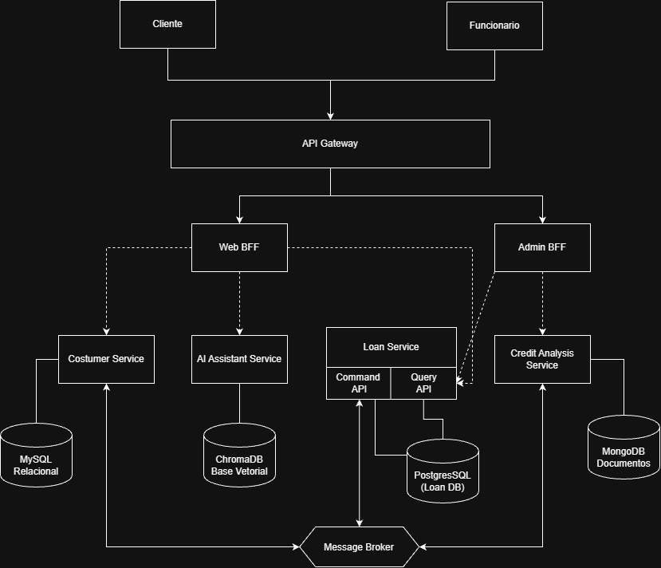
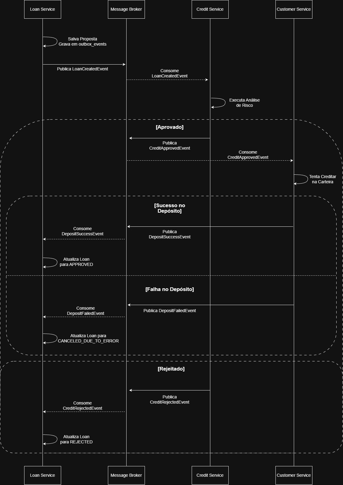

# CrediBot — Plataforma Distribuída de Microcrédito

Plataforma de microcrédito baseada em arquitetura de microsserviços distribuídos, orientada a eventos e assistida por inteligência artificial para orientação financeira e consulta em tempo real.

---

## Contexto e Problema

O acesso ao crédito formal no Brasil enfrenta desafios estruturais de inclusão e compreensão das condições financeiras por populações de baixa renda (Banco Central do Brasil, 2023). A complexidade no cálculo de taxas, prazos e regras de elegibilidade frequentemente atua como barreira de entrada.

O **CrediBot** resolve esse problema ao desacoplar a esteira de análise e concessão de microcrédito em serviços especializados de alta disponibilidade, integrando um assistente conversacional fundamentado em Retrieval-Augmented Generation (RAG) que esclarece termos contratuais e consulta posições de crédito em tempo real.

---

## Arquitetura do Sistema

O sistema é construído sobre o padrão **Database per Service**, garantindo autonomia de deploy, resiliência e persistência poliglota orientada à natureza de cada domínio.

### Visão Geral de Componentes

A topologia de rede, pontos de entrada e distribuição de responsabilidades estão ilustrados a seguir:



#### 1. Roteamento de Entrada e BFFs
- **API Gateway (Kong / Nginx):** Ponto único de terminação de tráfego externo. Responsável pelo *JWT Offloading* e aplicação de políticas de *Rate Limiting* (protegendo a infraestrutura interna e contendo custos operacionais com provedores de LLM).
  - Rotas `/web/*` ➔ direcionadas ao **Web BFF**.
  - Rotas `/admin/*` ➔ direcionadas ao **Admin BFF**.
- **Web BFF (Node.js):** Camada de agregação de dados para clientes finais. Filtra dados analíticos sensíveis, entregando payloads otimizados para consumo em redes móveis.
- **Admin BFF (Node.js):** Interface de backoffice para analistas de crédito. Expõe auditoria completa de risco, logs de execução do motor de decisão e métricas transacionais.

#### 2. Microsserviços de Domínio

| Serviço | Domínio | Persistência | Justificativa |
| :--- | :--- | :--- | :--- |
| **Loan Service** | Máquina de estados do ciclo de vida do empréstimo | PostgreSQL | Integridade relacional ACID, suporte a colunas JSONB e base para o Outbox Pattern. |
| **Customer Service** | Cadastro, conformidade KYC e saldo da carteira virtual | MySQL | Consistência relacional para transações de saldo e dados cadastrais. |
| **Credit Analysis Service** | Motor assíncrono de score e regras de crédito | MongoDB | Modelo documental para persistência de snapshots de risco variáveis e auditoria de regras. |
| **AI Assistant Service** | Processamento de linguagem natural e pipeline RAG | ChromaDB | Banco vetorial otimizado para busca por similaridade semântica de embeddings. |

---

### Transação Distribuída: SAGA Coreografada e Outbox Pattern

A concessão de crédito abrange três serviços distintos e opera sob o padrão **SAGA por Coreografia**. A consistência entre a escrita local e o envio de eventos no `Loan Service` é garantida via **Outbox Pattern**, evitando inconsistências causadas por *Dual Write*.



#### Fluxo de Execução:
1. **Início da Proposta:** O `Loan Service` registra a solicitação com status `PENDING` e insere o evento em sua tabela de outbox na mesma transação atômica. Um worker lê o outbox e publica o evento `LoanCreatedEvent` no Message Broker.
2. **Motor de Risco:** O `Credit Analysis Service` consome o evento, executa as políticas de score e publica `CreditApprovedEvent` (ou `CreditRejectedEvent`).
3. **Depósito na Carteira (Caminho Feliz):** O `Customer Service` consome a aprovação, valida o status da conta e credita o valor na carteira virtual, emitindo `DepositSuccessEvent`. O `Loan Service` consome o evento e altera o status para `APPROVED`.
4. **Transação Compensatória (Cenário de Falha):** Caso o `Customer Service` rejeite o depósito (e.g., conta bloqueada por suspeita de fraude via KYC), ele publica `DepositFailedEvent`. O `Loan Service` consome o evento compensatório e executa a compensação, atualizando o empréstimo para `CANCELED_DUE_TO_ERROR`.

---

### CQRS (Command Query Responsibility Segregation)

Aplicado no **Loan Service** para desacoplar operações transacionais de escrita de consultas de alta frequência:
- **Write Model:** Processa comandos de criação e alterações de status de propostas no PostgreSQL, garantindo integridade estrita.
- **Read Model:** Tabela desnormalizada otimizada para leituras paginadas e buscas textuais rápidas, sincronizada de forma assíncrona com tolerância a defasagem (lag) de 1 a 3 segundos (consistência eventual).

---

### Módulo de IA: RAG e Integração via Tools

O **AI Assistant Service** funciona de forma desacoplada da mensageria transacional:
- **RAG (Retrieval-Augmented Generation):** Manuais de crédito e regulamentos de taxas são vetorizados no ChromaDB. Perguntas do usuário recuperam os trechos mais aderentes como contexto antes do envio ao modelo, reduzindo alucinações.
- **LangChain Tools:** Dúvidas sobre status de empréstimo disparam uma Tool síncrona que executa requisição REST direta contra o modelo de leitura do `Loan Service`, retornando informações consolidadas em tempo real.
- **Tolerância a Falhas:** Chamadas externas a provedores de LLM implementam *Circuit Breaker*, *Timeouts* e *Fallback* gracioso em caso de indisponibilidade remota.

---

## Contratos de Interface

A especificação detalhada de contratos REST, códigos HTTP, HATEOAS e RFC 7807 (Problem Details) está centralizada no diretório [`/docs`](docs/):

- [`docs/contratos_rotas.pdf`](docs/contratos_rotas.pdf) — Especificação dos endpoints de cada microsserviço e BFF.

---

## Stack Tecnológica

- **Linguagens:** Java 21 (Spring Boot), TypeScript (Node.js)
- **Mensageria:** RabbitMQ
- **Bancos de Dados:** PostgreSQL, MySQL, MongoDB, ChromaDB
- **IA & Frameworks:** LangChain, OpenAI / Gemini API
- **Infraestrutura:** Docker, Docker Compose, Kubernetes (Minikube / k3d)
- **Gateways:** Kong / Nginx
- **Padrão de Commits:** [Conventional Commits](https://www.conventionalcommits.org/)

---

## Instruções de Execução

### Pré-requisitos
- Docker Engine `>= 24.0` e Docker Compose `>= 2.20`

### Inicialização do Ambiente
```bash
# 1. Clonar repositório
git clone https://github.com/petterdouglas/credibot-microservices.git
cd credibot-microservices

# 2. Subir bancos de dados, broker e microsserviços
docker compose up -d --build

# 3. Monitorar status dos containers
docker compose ps
```

---

## Referências

- BANCO CENTRAL DO BRASIL. **Relatório de Cidadania Financeira 2023**. Brasília: BCB, 2023. Disponível em: <https://www.bcb.gov.br/cidadaniafinanceira>.
- CHEN, Yupeng et al. **Retrieval-Augmented Generation for Financial Question Answering: Challenges and Approaches**. arXiv preprint, 2024. Disponível em: <https://arxiv.org/abs/2401.06080>.
- GARCIA-MOLINA, Hector; SALEM, Kenneth. **Sagas**. ACM SIGMOD Record, v. 16, n. 3, p. 249-259, 1987. Disponível em: <https://dl.acm.org/doi/10.1145/38714.38742>.
- PANDIYA, R.; CHARANKAR, N. **Optimizing Performance and Scalability in Micro Services with CQRS Design**. ResearchGate, maio 2024. Disponível em: <https://www.researchgate.net/publication/381069724>.
- RICHARDSON, Chris. **Microservices Patterns: With Examples in Java**. Manning Publications, 2018.
